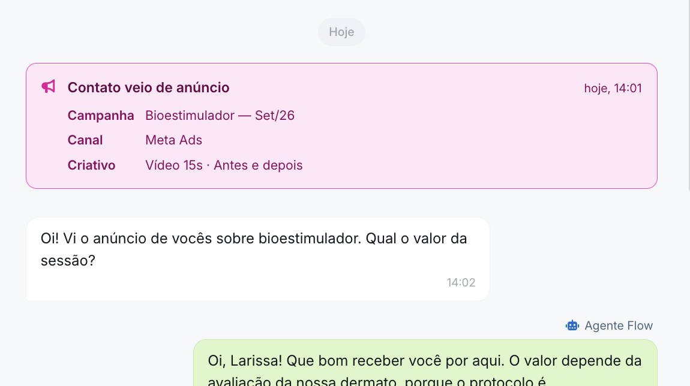

# Rastreio de anúncios do Meta Ads

Quando alguém clica em um anúncio da sua clínica no Facebook ou no Instagram e começa uma conversa no WhatsApp, o Amigo Flow identifica automaticamente que aquele contato veio de um anúncio e mostra qual anúncio foi.

Assim, sua equipe sabe de onde cada paciente chegou, e você consegue entender quais anúncios estão realmente trazendo conversas.


&#x20;Não é preciso conectar sua conta de anúncios ao Amigo Flow. Como somos parceiros oficiais da Meta para o WhatsApp, a informação do anúncio chega junto com a primeira mensagem do paciente.&#x20;


### Como funciona

1. Sua clínica (ou agência) publica um anúncio no Meta Ads com o botão **Enviar mensagem pelo WhatsApp**.
2. A pessoa vê o anúncio no Facebook ou Instagram e clica no botão.
3. O WhatsApp abre já com uma conversa com o número da sua clínica, e a pessoa envia a mensagem.
4. Junto com essa mensagem, a Meta envia ao Amigo Flow os dados do anúncio que originou o contato.
5. O contato aparece no Amigo Flow identificado como vindo de anúncio, com as informações do anúncio disponíveis para a sua equipe.

### O que você vê no Amigo Flow

<figure><figcaption></figcaption></figure>

Para cada contato que chegou por um anúncio, o Amigo Flow registra as informações que a Meta envia:

| Informação   | O que é                                                              |
| ------------ | -------------------------------------------------------------------- |
| **Origem**   | Indica que o contato veio de um anúncio do Meta (Click-to-WhatsApp). |
| **Campanha** | O título da campanha/anúncio                                         |
| **Canal**    | Meta Ads                                                             |
| **Criativo** | Indica se o anúncio era de imagem ou vídeo.                          |

Além disso, quando um Lead, tem origem através de um clique de anúncio, registramos isso na origem, no perfil do Lead.

<figure><figcaption></figcaption></figure>

### O que você precisa para começar

Antes de publicar seus anúncios, confira:

* [ ] O número de WhatsApp da clínica está conectado ao Amigo Flow.
* [ ] Sua **Página do Facebook** (e, se for anunciar no Instagram, sua conta do Instagram) está no mesmo portfólio empresarial da Meta que o seu número de WhatsApp.
* [ ] O número de WhatsApp está vinculado à Página do Facebook.
* [ ] A conta de anúncios que vai veicular as campanhas tem acesso a essa Página.

Pronto: não há nenhuma configuração extra a fazer dentro do Amigo Flow.

### Como criar um anúncio que será rastreado

No **Gerenciador de Anúncios** da Meta:

1. Crie uma campanha com objetivo de **Engajamento**, **Leads** ou **Vendas**.
2. No conjunto de anúncios, escolha **Aplicativos de mensagens** como local da conversão e selecione **WhatsApp**.
3. Selecione o número de WhatsApp da clínica que está conectado ao Amigo Flow.
4. Se quiser, configure uma mensagem de boas-vindas ou uma mensagem já preenchida para o paciente.
5. Publique o anúncio.


O anúncio precisa direcionar para o **mesmo número** que está conectado ao Amigo Flow. Anúncios que levam para outro número não aparecem no Flow.&#x20;


### Quais anúncios são rastreados

O rastreio funciona para anúncios que **abrem uma conversa no WhatsApp** (os chamados anúncios Click-to-WhatsApp).

Outros caminhos que levam pacientes até você continuam chegando normalmente no Amigo Flow, mas sem a identificação automática do anúncio. Por exemplo:

* Anúncios que levam para o seu site ou para um formulário de cadastro.
* Links de WhatsApp colocados na bio do Instagram, em posts orgânicos ou em stories.
* Pessoas que salvaram seu número e mandaram mensagem depois.

### Perguntas frequentes

**Preciso pagar algo a mais para usar o rastreio?** Não. O rastreio faz parte do Amigo Flow e funciona assim que seu anúncio começa a rodar.

**Funciona para anúncios no Instagram?** Sim. Anúncios no Facebook e no Instagram que abrem conversa no WhatsApp são rastreados da mesma forma.

**Minha agência cria os anúncios. Ela precisa fazer algo diferente?** Não. Basta que a agência use o número de WhatsApp conectado ao Amigo Flow como destino dos anúncios.

**Por que um contato que clicou no anúncio não aparece como vindo de anúncio?** Isso pode acontecer quando a pessoa não envia mensagem logo após clicar (e volta a falar com você depois, por outro caminho) ou quando a Meta não envia os dados do anúncio naquela conversa. Nesses casos, o contato chega normalmente, só sem a identificação do anúncio.

